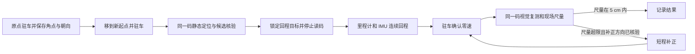

# AprilTag 机器人回原点

在地面标定点保存一张固定 AprilTag 的视觉参考。机器人移到新位置后，在驻车时做一次视觉定位并确定回程目标，随后由轮式里程计和 IMU 闭环执行一段连续回程。停车后用同一张码复测，最终以现场尺量验收 **5 cm**。

仓库包含 155 机器人使用胸部 D455 和 **50 mm · ID 4** 回原点的代码，以及可离线复算的第 4 轮角点样例。实测部分汇总了 2026 年 11 月 11–12 日使用 **40、50、65、160 mm** 四种 `tag36h11` 码的停车记录。尺寸均指黑框实测边长。



## 1. 原点标定

1. 用地面标记固定原点和车头朝向，记录以后用来尺量的同一个车体测量点。机器人对齐后驻车，保存当时的底盘位置与航向，并记录腰部姿态。
2. 固定 AprilTag 的位置和朝向，使用胸部 D455 的 `1280×720 / 15 Hz` 图像。在本轮原点，镜头到码中心的斜距约 **2.51 m**。这个距离和机器人移开后到地面原点的回程距离是两项不同的测量。
3. 对静态角点取中位数，结合相机内参和 50 mm 黑框边长，用 OpenCV 的 IPPE 求出平面码的姿态候选并保存原点参考。保存两个候选便于复核，单凭重投影误差的排名容易选错朝向。

实跑取原图 ROI 做 **5× Lanczos 插值**，再做系数 `0.6` 的反锐化掩模。AprilTag 在放大后的图像上检测，PnP 和重投影拟合使用映射回原图的角点坐标。若 `p` 是插值图中的坐标、`o` 是 ROI 原点，则原图坐标为 `o + (p + 0.5) / 5 - 0.5`。插值改善了角点提取条件，图像的原生分辨率仍是 `1280×720`。检测和几何计算分别由开源 AprilTag 和 OpenCV 执行。[AprilTag](https://github.com/AprilRobotics/apriltag) · [Python 绑定](https://github.com/chibai/apriltag-python)

## 2. 新位置单段回程

1. 将机器人移到新位置并驻车，保持码板和腰部姿态，确认返回路径畅通。启动前用同一码采集静态窗口。一次视觉定位指为整段回程锁定一次目标，静态窗口包含多帧。
2. 先列出只用图像得到的候选，再以原点和新起点的底盘相对航向约束拟合，估计平面位置和相机的表观俯仰偏差。用独立的起点位移参考核对拟合值。实跑对起步图像只接收零位纠错的 ID 4，检查多个静态窗口的一致性，并要求角点拟合 RMS 在 **0.35 个原始像素**以内。候选仍有明显分歧时，先解决姿态多解再决定方向。
3. 原点坐标中 `x` 向前、`y` 向左，航向左转为正。设新起点偏移为 `p = [x, y]`，相对原点朝向为 `ψ`，车体坐标下的回程平移是 `−R(−ψ)p`，目标转角是 `−ψ`。第 4 轮复算给出的车体目标约为前进 **18 cm**、右移 **63 cm**、右转 **11.9°**，平移合计约 **0.66 m**。
4. 通过预检后锁定目标并关闭采图和检测进程。底盘使用轮式里程计估计平移，使用静态去偏后的 IMU 陀螺仪更新航向，持续修正速度指令。试验没有接入点云和局部避障。停止条件依据底盘反馈，停车后发送零速并确认驻车。

## 3. 停车复测与补正

1. 确认驻车和零速，重新采集同一码，使用相同的 ROI 处理方式及原点参考。以停稳时相对原点的 IMU 航向约束拟合，记录视觉平面偏移、候选和重投影 RMS。停偏方向由原点坐标下的 `x`、`y` 确定，视觉复测本身不发送运动指令。
2. 在地面用原来的车体测量点尺量，记录前后和左右偏差。有分量时以 `√(x² + y²)` 判定是否在 5 cm 内。现场只给出门槛判断时，保留“在 5 cm 内”或“超过 5 cm”，精确数值记为未记录。
3. 若尺量超限，先核对复测的分支、方向与现场位置，再把选定的偏移换成车体坐标下的反向补正。短程控制器支持大于 **1.5 cm**、不超过 **15 cm** 的平移补正。再次停稳后重复读码和尺量，分别记录第一段和补正后的结果。

## 4. 5 cm 实测结果

“回程目标”是起步时用于控制的位移。“视觉复测”是停车后相对地面标定点的估计，使用航向约束时单独注明。“现场尺量”采用原车体测量点，现有记录只保留是否在 5 cm 内的判定。做过补正但缺少视觉复测时，表内写“未复测”。

### 4.1 50 mm · ID 4（5× Lanczos 插值加锐化）

| 轮次 | 首段回程目标 / 运行 | 首停视觉估计 | 首停现场尺量 | 补正后视觉估计 | 补正后现场尺量 |
| --- | --- | --- | --- | --- | --- |
| 1 | 约 0.71 m / 86.5 s | 12.4 cm | 未记录 | 4.8 cm（补正约 15.8 s） | **在 5 cm 内** |
| 2 | 约 0.93 m / 102.6 s | 6.5 cm | **在 5 cm 内** | 未补正 | 未补正 |
| 3 | 约 0.55 m / 70.3 s | 10.8 cm | **超过 5 cm** | 1.3 cm（补正约 14.3 s） | **在 5 cm 内** |
| 4 | 约 0.65 m / 75.7 s | 9.8 cm | **在 5 cm 内** | 未补正 | 未补正 |

四轮最终停点均经现场确认在 5 cm 内，其中第 2、4 轮有明确的单段达标记录。表中的视觉值来自停车后角点和 IMU 航向。第 4 轮底盘估计的 **1.3 cm** 是相对首段控制目标的余量，同轮停车后的视觉估计为 **9.8 cm**。尺量只记录了门槛判断，无法据此计算视觉偏差的精确数值。试验采用局部平面模型，完整的相机到车体光学外参尚未独立验收。

### 4.2 40、65、160 mm 历史实跑

| 码与试验 | 角点检测输入 | 首段回程目标 / 运行 | 首停视觉估计 | 首停现场尺量 | 补正后视觉估计 | 补正后现场尺量 |
| --- | --- | --- | --- | --- | --- | --- |
| 40 mm · ID 2，首次实跑 | 5× Lanczos 加锐化 | 约 0.58 m / 62 s | 未记录 | **超过 5 cm** | 未补正 | 未补正 |
| 40 mm · ID 2，现场尺量辅助起步 | 首段 5× Lanczos 加锐化，补正后用 5× 无锐化复测 | 约 0.64 m / 69 s | 单码有 **33 cm、124 cm** 两个候选。补正前重新采图，结合 IMU 估计左偏约 2.7 cm | 未记录 | 右移补正后约 **0.9 cm**（视觉与 IMU，32/135 帧检出） | **超过 5 cm** |
| 40 mm · ID 2，航向约束单段回程 | 首段 5× Lanczos 加锐化，停车复测比较 5× 无锐化及两档锐化 | 约 0.43 m / 50 s | 结合 IMU 约 **4.5 cm**，用底盘航向约 **12 cm**。单码候选约 **17–19 cm、135–137 cm**，最多 4/136 帧检出 | **在 5 cm 内** | 未补正 | 未补正 |
| 40 mm · ID 2，换起点复测 | 5× Lanczos，起步加锐化，停车复测比较不同锐化强度 | 约 0.67 m / 74 s | 结合 IMU 约 **3.5 cm** | 未记录 | 短程补正后约 **2.3 cm**（视觉与 IMU） | **超过 5 cm** |
| 65 mm · ID 4，三视角标定后单段回程 | 2× 双三次插值 | 约 0.28 m / 30 s | 未复测 | **在 5 cm 内** | 未补正 | 未补正 |
| 65 mm · ID 4，换起点后补正 | 2× 双三次插值 | 约 0.90 m / 94 s | 拟合较优候选约 **22.3 cm**（后 4.2 cm、右 21.9 cm），另一候选约 **64.7 cm**，横向方向相反 | **超过 5 cm** | 未复测。现场确认右偏后选定回程分支，补正约 30 s | **在 5 cm 内** |
| 160 mm · ID 0，早期连续回程 | 原始 1×，未插值 | 约 0.95 m / 97 s | 约 **13.0 cm** | **超过 5 cm** | 第二段后约 **8.1 cm**，第三段后约 **2.8 cm** | 第二段后**超过 5 cm**，第三段后**在 5 cm 内** |
| 160 mm · ID 0，起步读码后单段回程 | 原始 1×，未插值 | 约 0.73 m / 84 s | 未复测 | **在 5 cm 内** | 未补正 | 未补正 |
| 160 mm · ID 0，长距离回程后补正 | 原始 1×，未插值 | 约 1.56 m / 165 s | 约 **11.3 cm**（后 3.4 cm、右 10.8 cm） | **超过 5 cm** | 补正约 11 s，停后约 **2.0 cm**（后约 0.6 cm、右约 2.0 cm） | **在 5 cm 内** |

160 mm 早期连续回程在行驶中仍监看视觉，后两项和小码试验采用起步读码、途中由里程计和 IMU 执行。65 mm 约 0.90 m 这轮补正后的 **1.4 cm** 来自控制器，停车后没有再次读码。40 mm 约 0.64 m 这轮用现场粗量的前 50 cm、左 40 cm 确定起步平移量，视觉估计航向。

插值试验在放大图上检测角点，后续用换回原始像素的坐标计算位姿。40 mm 另做过原始 1× 静态预检，旧 ROI 两批图均未检出（0/226、0/120），调整 ROI 后，同一批 131 帧在原始 1× 和 5× 下均检出 ID 2。这些是静态检出记录，表内 40 mm 的实际回程均使用 5×。

## 5. 离线复算

用 Python 3.11 在仓库根目录运行。样例只含角点与测量摘要，可以在无相机、无 ROS 的电脑上运行。

```sh
python -m pip install -r requirements.txt
python tools/replay_round4.py
```

也可以分开执行标定与停车复测。样例中的 `0.93838°` 是该轮停车后保存的相对 IMU 航向。

```sh
python tools/estimate.py calibrate --geometry examples/camera_geometry.json --corners examples/origin_corners.jsonl --output origin.json
python tools/estimate.py estimate --reference origin.json --corners examples/parked_corners.jsonl --heading-deg 0.93838
```

输出的 `image_only_candidates` 是只用图像角点的位姿候选。`offset_xy_m` 是加入航向约束后的原点坐标偏移，`body_return_xy_m` 是在当前车体坐标下对应的回程位移。第 4 轮用原点候选 `reference_branch=1`，起步样例筛出 **114/131** 帧零位纠错角点，停车后样例筛出 **166/166** 帧。公开样例的相机参数适用于复算这批数据，上机需核对现场内参和安装几何。[第 4 轮记录](examples/round4.json)

## 6. 实机代码与部署入口

| 入口 | 用途 |
| --- | --- |
| [`tools/capture_latest.py`](tools/capture_latest.py) / [`tools/sample_corners.py`](tools/sample_corners.py) | Linux V4L2 采图、指定 ROI 静态读码和保存原始像素角点 |
| [`tools/estimate.py`](tools/estimate.py) / [`tools/prepare_return.py`](tools/prepare_return.py) | 保存原点参考、复测候选、用独立位移参考核验并准备起步记录 |
| [`motion_trial_20261109/return_to_origin.py`](motion_trial_20261109/return_to_origin.py) | 起步定位、锁定目标、里程计和 IMU 单段回程 |
| [`motion_trial_20261109/short_correction.py`](motion_trial_20261109/short_correction.py) | 执行已核验的车体坐标短距离平移补正 |
| [`motion_trial_20261109/run.sh`](motion_trial_20261109/run.sh) | 在宿主机采图，启动容器内的 ROS 2 控制器和独立停车监视器 |

部署需要 Linux 宿主机、已挂载仓库的厂家 ROS 2 容器及其 `move`、`driver` 消息和服务。预检还读取腰部 EtherCAT 编码器。实验底盘在 `/controller/odom` 中用 `orientation.w` 携带原生偏航弧度，接入其他底盘前需要核对反馈格式和指令方向。

静态采集时，在宿主机和有视觉依赖的环境中分别执行以下两条命令。`ROI_X`、`ROI_Y`、`ROI_W`、`ROI_H` 是原图的裁剪范围。每个位置使用新的记录文件，采集宿主机和容器通过挂载目录交换帧。

```bash
# 宿主机
python3 tools/capture_latest.py --device "$APRILTAG_CAMERA_DEVICE" \
  --serial "$APRILTAG_CAMERA_SERIAL" --output-dir runtime/static --duration 30

# 采图期间在视觉环境中执行
python3 tools/sample_corners.py --latest-dir runtime/static \
  --serial "$APRILTAG_CAMERA_SERIAL" --roi "$ROI_X" "$ROI_Y" "$ROI_W" "$ROI_H" \
  --duration 12 --max-hamming 0 --output config/local/start_corners.jsonl
```

原点用 `estimate.py calibrate --native-odom X Y YAW_RAD` 一并保存驻车反馈。新起点用 `tools/prepare_return.py --reference … --corners … --start-odom X Y YAW_RAD --comparison-xy X_M Y_M --original-reference-id … --output …` 生成起步记录。`--comparison-xy` 是独立测量或核验得到的原点坐标偏移，单位为米。补正记录使用停稳时的 `checked_native_pose` 和已核验的 `correction_body_m`。

复制[本机配置模板](config/profile.example.json)到 `config/local/profile_<会话名>.json`，填写现场串联核验记录、腰部反馈、ROI、运动增益与 SHA-256，按[核验清单模板](config/validation.example.json)绑定实际检查过的文件。配置里的 `tag40_trial_record` 和 `user_authorized_tag40_id2_trial` 是保留的历史字段名，本版回程验证的是 50 mm ID 4。`reference` 绑定早先用 160 mm ID 0 完成的底盘轴向核验记录，实际回程和复测只读取 ID 4。模板中的空值和未核验状态会拒绝启动。

设置 `APRILTAG_CONTAINER`、`APRILTAG_CONTAINER_ROOT`、`APRILTAG_ROS_ENV`、`APRILTAG_CAMERA_DEVICE` 和 `APRILTAG_CAMERA_SERIAL` 后，使用现场会话名运行。`--check` 写入 `reports/preflight/`，`--execute` 会发送实机运动指令并写入 `reports/`。补正换用 `short` 和独立会话。

```bash
bash motion_trial_20261109/run.sh return --check "$SESSION"
bash motion_trial_20261109/run.sh return --execute "$SESSION"
```

公开版重新整理了入口与本地配置，离线样例可复算。表中的实机结果来自原试验部署，这次整理未重跑机器人。
